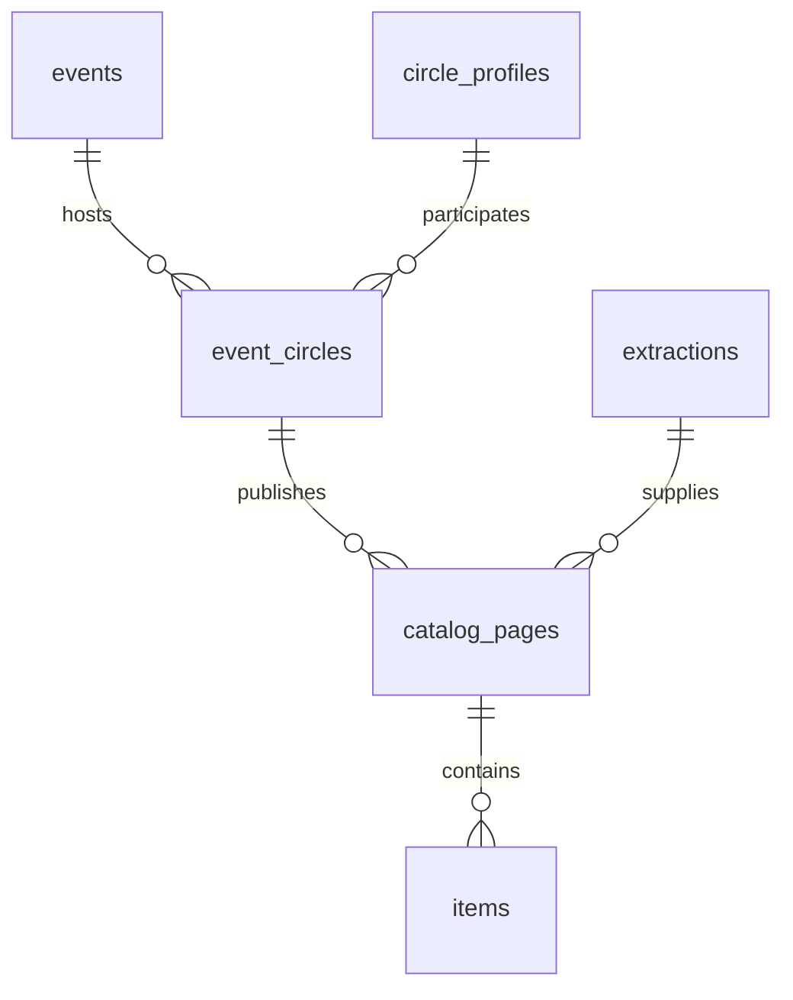

# Event catalog data model

Each circle has a persistent identity and a separate participation at each event.
CF23 and CF24 can have different booth allocations, products, and prices. Items
belong to the participation through their extracted catalog page, so prices are
never shared across events automatically.



| Table/view | Meaning | Main fields |
| --- | --- | --- |
| `events` | An event edition, e.g. `cf23` | `id`, `name`, `start_date`, `map_url` |
| `circle_profiles` | Persistent circle identity across editions | `id`, `name` |
| `event_circles` | A circle participating in one event | `id`, `event_id`, `circle_profile_id`, `display_name`, `schedules_json` |
| `catalog_pages` | A particular extracted image version for that participation | `id`, `event_circle_id`, `source_url`, `image_source`, `extraction_key`, `extracted_at`, `is_current` |
| `items` | One VLM-observed item in a catalog page | `id`, `catalog_page_id`, `position`, `name`, product/price fields, evidence/confidence, `review_status` |
| `event_items` | View of items from current page versions with event/circle/source information | All item fields plus `event_id`, `circle_profile_id`, `event_circle_id`, `circle_name`, schedules and provenance |

The original `circles`, `sources`, `extractions`, and `results` tables remain as
upstream import/cache data for backward compatibility. In those original tables,
`circle_id` identifies the event-specific upstream map entry; use `circle_profiles`
for the persistent identity. The IDs used by existing ingest/crawl commands remain
valid and correspond to `event_circles.id`.

## Items

`name`, `category`, `fandom`, `characters_json`, `variants_json`, and `availability`
come from the VLM. Unknown optional fields remain SQL NULL. Array fields are JSON
arrays, not comma-separated strings. `price_text` preserves the exact printed
price; `price_amount` is a nonnegative numeric display value, and `currency` is
nullable. An unknown price remains NULL rather than zero. Ranges and bundle prices
may have only `price_text`. Numeric prices are not intended as a checkout ledger.

`evidence_text`, `confidence`, and the page link preserve the reasoning evidence
and original image reference. Confidence is self-reported, not calibrated.
`review_status` is `needs_review`, `approved`, or `rejected`; new observations always
start at `needs_review`. Do not expose unreviewed or rejected items as verified.

These are **observations per catalog page**, not deduplicated global SKUs. The same
product appearing on multiple pages can create multiple observations. Product
deduplication and mapping variants into a storefront SKU are a later review step.
Booth numbers come from the imported event participation; VLM-read booth text in
the raw extraction is never allowed to reassign an item to a different circle.

## Imports, history, and identity

```sh
cargo run -- sync --event cf23 --event-name 'Comic Frontier 23'
# When a CF24 source is available, explicitly select its URL and edition:
cargo run -- sync --event cf24 --event-name 'Comic Frontier 24' --map-url 'https://your-cf24-map.example/'
```

Event identifiers are explicit to prevent silently assigning a new edition to
CF23. Reassigning an existing map entry to another event is rejected. Known legacy
CF23 metadata is backfilled on opening the local database; unknown editions need
an explicit `sync --event`. No CF24 dates or data are seeded in production.

A new map entry initially gets a separate profile. Names alone are not reliable
identity keys, and upstream indices may change between events. After verifying a
returning circle's identity, reuse its profile:

```sh
cargo run -- link-circle --participation 'NEW_EVENT_MAP_ENTRY_ID' --profile 'EXISTING_PROFILE_ID'
```

Look up profile IDs in `event_circles` or `circle_profiles`. The link remains after
later syncs; event-specific names and booth allocations remain separate. There can
be only one participation per event/profile. Unused initial profiles are retained.

Items and pages have deterministic IDs. Reprocessing the same image/extraction
does not duplicate item rows or reset reviews. A changed extraction adds a page
version and retires the previous one for the same participation/source/image
reference. Historical pages/items remain in their tables; `event_items` selects
only current versions. A new image URL is a new page, not automatically a revision
of another URL. Switching versions and inserting items is one local transaction.

## Browse in D1 Studio

All current VLM item observations at CF23:

```sql
SELECT circle_name, name, category, fandom, price_text, currency,
       review_status, confidence, image_source
FROM event_items
WHERE event_id = 'cf23'
ORDER BY circle_name, name;
```

Approved items from one circle across editions:

```sql
SELECT event_id, name, price_text, image_source
FROM event_items
WHERE circle_profile_id = 'YOUR_PROFILE_ID'
  AND review_status = 'approved'
ORDER BY event_id, name;
```

Every CF23 circle, including those without scraped items:

```sql
SELECT ec.id, ec.display_name, ec.circle_profile_id,
       ec.schedules_json, COUNT(i.id) AS current_item_count
FROM event_circles ec
LEFT JOIN event_items i ON i.event_circle_id = ec.id
WHERE ec.event_id = 'cf23'
GROUP BY ec.id
ORDER BY ec.display_name;
```

Mark a reviewed item using its exact item ID:

```sql
UPDATE items SET review_status = 'approved' WHERE id = 'YOUR_ITEM_ID';
```

## D1 upload and JSON export

`d1-push` creates the new tables/view without removing existing data. All parent
rows upload before dependent rows. Historical page versions are retired before
new current versions upload. Uploads are idempotent but not atomic across the
whole database; rerun if interrupted. D1 review statuses are preserved on row
conflicts. Other fields remain controlled by the scraper. Remote review changes
are not pulled into local SQLite by this one-way uploader.

JSON exports use `schema_version: 2`, with top-level `events` and `circles`.
Each circle adds `event_id`, `circle_profile_id`, and current `items`, while keeping
the previous metadata and raw `catalogs`. Raw catalog review flags remain separate
from individual item reviews. Local JSON exports reflect local review state.

## Instagram capture and duplicate review

Instagram posts now use the Playwright carousel screenshotter. `source_coverage`
stores the method (`playwright`), status (`complete`, `partial`, `blocked`), slide
count, local manifest path, and capture time. Complete describes browser capture,
not a human-verified extraction. Caps and failed navigation remain partial. Legacy
preview-only links are automatically eligible for browser reprocessing.

`image_fingerprints` indexes decoded pixels and perceptual hashes.
`catalog_page_duplicates` and `item_duplicates` link a suspected duplicate to an
earlier observation. Their `decision` is `candidate`, `confirmed`, or `rejected`;
`active` excludes obsolete comparisons. Exact-image reposts within an event/circle
can be confirmed deterministically. Other visual/item-field matches remain review
candidates. Different prices, variants, circles, and editions are kept separate.
No observation or evidence row is deleted.

```sql
SELECT circle_name, name, price_text
FROM unique_event_items
WHERE event_id = 'cf23';

SELECT d.*, i.name
FROM item_duplicates d JOIN items i ON i.id=d.item_id
WHERE d.active=1 AND d.decision='candidate';

SELECT source_url, method, status, slide_count, captured_at
FROM source_coverage
WHERE circle_id = 'cf.mikira.id:2026-10-31:1076';
```

`scrape_run_state` records the all-batches worker's state, including quota waits
and completion with failure counts. Inaccessible posts are not counted as scraped.
`d1_sync_state` is a local upload ledger keyed by destination/table/primary key;
only changed rows are transmitted to limit D1 writes at repeated checkpoints.
